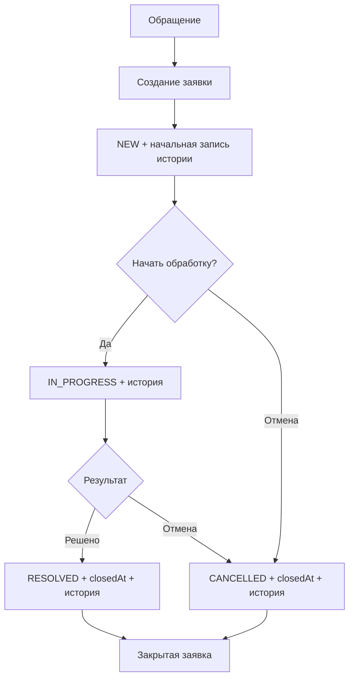
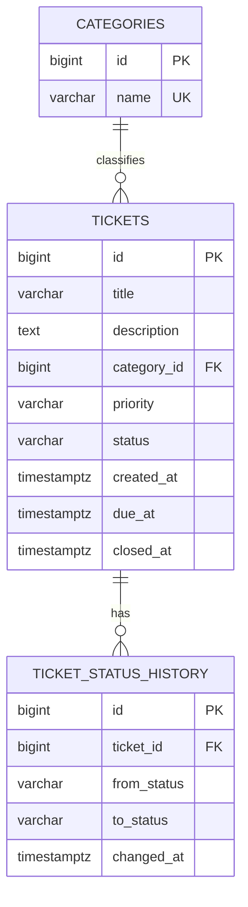

# Спецификация сервиса обработки заявок

**Версия:** 1.0. Документ составлен по заданию практики и фактическому исходному коду проекта.

## 1. Назначение и проблема

В организации обращения в техническую поддержку поступают через разные каналы. Из-за отсутствия единого учёта сотрудники могут терять обращения, не видеть текущий статус и срок выполнения, а статистика готовится вручную. Цель проекта — единый REST-сервис для регистрации заявок, контроля статусов и сроков, хранения истории и формирования статистики.

## 2. Пользователи

| Роль | Потребность |
|---|---|
| Сотрудник, принимающий обращение | Создать заявку, выбрать категорию, приоритет и срок |
| Специалист поддержки | Просматривать, редактировать открытые заявки и менять статус |
| Руководитель поддержки | Получать статистику за период |
| Оператор системы | Запускать сервис, контролировать доступность и сохранность данных |

В текущей версии аутентификация и разграничение прав не реализованы.

## 3. Границы проекта

**Входит:** REST API, заявки, категории, статусы, история, фильтрация, пагинация, просрочка, отчёт, PostgreSQL, Flyway, OpenAPI, Docker Compose.

## 4. Предметная область

Заявка содержит: `id`, `title`, `description`, `category`, `priority`, `status`, `createdAt`, `dueAt`, `closedAt`.

- Заголовок обязателен и не может быть пустым.
- Категория обязательна и должна существовать.
- Приоритет: `LOW`, `MEDIUM`, `HIGH`.
- Начальный статус: `NEW`.
- `createdAt` устанавливается сервером.
- `dueAt` обязателен.
- `closedAt` устанавливается при переходе в `RESOLVED` или `CANCELLED`.
- Просроченной считается заявка со статусом `NEW` или `IN_PROGRESS`, если `dueAt < now` (строго меньше).

### Машина состояний

| Текущий статус | Разрешённые переходы |
|---|---|
| NEW | IN_PROGRESS, CANCELLED |
| IN_PROGRESS | RESOLVED, CANCELLED |
| RESOLVED | Нет |
| CANCELLED | Нет |

Закрытые и отменённые заявки нельзя редактировать или повторно открывать. Запрещённый переход возвращает HTTP 409. Изменение статуса и запись истории выполняются в одной транзакции. При создании создаётся начальная запись `null → NEW`.

## 5. Функциональные требования

| ID | Требование | Реализация |
|---|---|---|
| FR-01 | Создание заявки | `POST /api/tickets` |
| FR-02 | Начальный статус NEW | Доменная модель Ticket |
| FR-03 | Получение заявки по ID | `GET /api/tickets/{id}` |
| FR-04 | Редактирование описания, приоритета и срока | `PATCH /api/tickets/{id}` |
| FR-05 | Запрет редактирования закрытых заявок | `Ticket.isEditable()` + TicketService |
| FR-06 | Проверка переходов статуса | `TicketStatusMachine` |
| FR-07 | История начального и последующих статусов | `ticket_status_history` |
| FR-08 | Просмотр истории | `GET /api/tickets/{id}/history` |
| FR-09 | Список с фильтрами и пагинацией | `GET /api/tickets` |
| FR-10 | Фильтры статус/приоритет/категория | Query-параметры списка |
| FR-11 | Фильтр просрочки | `overdue=true` |
| FR-12 | Справочник категорий | `GET /api/categories` |
| FR-13 | Сводный отчёт | `GET /api/reports/summary` |
| FR-14 | Единый формат типовых ошибок | `GlobalExceptionHandler` |

**Известное расхождение:** `overdue=true` фильтрует просроченные открытые заявки, но `overdue=false` в текущем коде не включает обратный фильтр и фактически игнорируется (D-03).

## 6. Требования к отчёту

`GET /api/reports/summary?from=...&to=...` использует интервал создания `[from, to)`: `createdAt >= from` и `createdAt < to`. Все показатели рассчитываются по одной выборке.

Ответ включает:
- `totalCreated` — число заявок, созданных в периоде;
- `byStatus` — распределение по текущему статусу;
- `byPriority` — распределение по приоритету;
- `openOverdue` — количество заявок в NEW/IN_PROGRESS с `dueAt < now` среди выбранной выборки;
- `avgResolutionMinutes` — среднее время `closedAt - createdAt` для `RESOLVED` с ненулевым `closedAt`.

Если завершённых заявок нет, среднее равно `null`. Если `from >= to`, запрос отклоняется с HTTP 400.

## 7. Нефункциональные требования

| ID | Требование | Состояние по проекту |
|---|---|---|
| NFR-01 | Воспроизводимый запуск | Compose есть; требуется чистая проверка |
| NFR-02 | Сохранность после перезапуска | Настроен named volume `pgdata`; проверить экспериментом |
| NFR-03 | Конфигурация через env | Compose передаёт DB-переменные, но пароль в application.yml задан литералом (D-01) |
| NFR-04 | Нет секретов в репозитории | Требует исправления/проверки D-01 |
| NFR-05 | Миграции схемы | Flyway включён, V1 создаёт таблицы и категории |
| NFR-06 | Единый формат ошибок | Обработчик 400/404/409 есть |
| NFR-07 | Health check | Actuator и Compose healthcheck настроены |
| NFR-08 | Управляемое время | Внедряется `Clock`, есть тестовый изменяемый Clock |
| NFR-09 | Документация API | Springdoc подключён |
| NFR-10 | CI/CD | Pipeline в архиве не обнаружен |

## 8. Архитектура

Один Spring Boot сервис и PostgreSQL. Java реализует REST-контроллеры, доменные сущности, сервис заявок, репозитории и Java-адаптер отчёта. Kotlin реализует `ReportService` и data class моделей отчёта. Java-контроллер вызывает Kotlin-сервис; Kotlin получает строки через Java-интерфейс `TicketReportDataPort`, реализация `JpaTicketReportDataAdapter` выполняет JPQL через `EntityManager`. Flyway управляет схемой.

### Процесс обработки заявки

### ER-диаграмма

## 9. Backlog

Оценки предварительные, в часах; это не фактический учёт времени.

| ID | Задача | Приоритет | Оценка |
|---|---|---:|---:|
| B-01 | Анализ предметной области и требований | Высокий | 2 |
| B-02 | Истории и критерии приёмки | Высокий | 2 |
| B-03 | ER и диаграмма процесса | Высокий | 2 |
| B-04 | Модель данных и Flyway | Высокий | 4 |
| B-05 | CRUD API заявок | Высокий | 5 |
| B-06 | Статусы и история | Высокий | 4 |
| B-07 | Фильтры и пагинация | Высокий | 3 |
| B-08 | Kotlin-отчёт и Java/Kotlin-интеграция | Высокий | 6 |
| B-09 | Unit и integration тесты | Высокий | 8 |
| B-10 | E2E и регрессионные тесты | Высокий | 4 |
| B-11 | Docker/Compose и эксплуатация | Средний | 6 |
| B-12 | CI/CD и доставка | Высокий | 8 |
| B-13 | Документация и защита | Средний | 4 |
